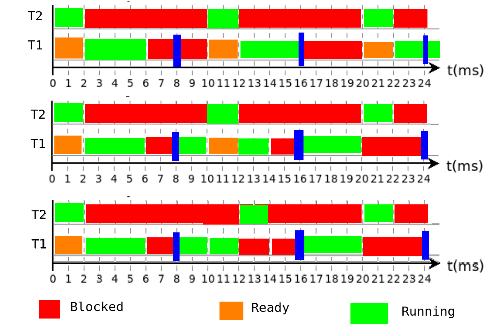

# TD RTOS

## 1/ Tâches

```c
#include <stdio.h>
#include <FreeRTOS.h>
#define STACK_DEPTH 256
#define BASE_PRIO 1
int x = 0;
void codeTache(void* num) {
	int j;
	for (j = 0 ; j < 10 ; j++) {
		x++;
		printf("tache %d, j = %d, x = %d\r\n", (int)num, j, x);
		vTaskDelay(1);
	}
	vTaskDelete(NULL);
}
/* Tâche de priorité BASE_PRIO */
void init(void* param) {
	int i;
	TaskHandle_t xHandle = NULL;
	for (i = 0 ; i < 4 ; i++) {
		xTaskCreate(codeTache, "", STACK_SIZE, (void *) i, BASE_PRIO+i+1, &xHandle);
		printf("Creation de la tache %d\r\n", i);
	}
	vTaskDelete(NULL);
}
```

__1. Donner les 12 premières lignes qui s'affichent à l'écran__
```
tache 0, j = 0, x = 1 Creation de la tache 0 tache 1, 
j = 0, x = 2 Creation de la tache 1 tache 2, 
j = 0, x = 3 Creation de la tache 2 tache 3,
j = 0, x = 4 Creation de la tache 3 tache 3, 
j = 1, x = 5 tache 2, 
j = 1, x = 6 tache 1, 
j = 1, x = 7 tache 0, 
j = 1, x = 8 tache 3, 
j = 2, x = 9 tache 2, 
j = 2, x = 10 tache 1, 
j = 2, x = 11 tache 0, 
j = 2, x = 12,
```
__2. La fonction codeTache est-elle réentrante ?__
```

```
___

## 3/ Boîtes aux lettres

```c
#define BASE_PRIO 5
#define STACK_SIZE 1000
#define NBR_MAX 3
#define LONG_MAX 100
QueueHandle_t maBoite;
void tache2 (void* p) {
	char messBuf[LONG_MAX];
	int i;
	printf("t2: alive\r\n");
	for (i = 0 ; i < 5 ; i++) {
		xQueueReceive(maBoite, (void *)messBuf, portMAX_DELAY);
		printf("t2: R %s\r\n", messBuf);
	}
	printf("t2 out\r\n");
	vTaskDelete(NULL);
}
void tache1(void* p) {
	char msg[] = "msg 00";
	int i;
	printf("t1: alive\r\n");
	maBoite = xQueueCreate(NBR_MAX, LONG_MAX);
	printf("t1: created Queue\r\n");
	for (i = 0 ; i < 5 ; i++) {
		sprintf(msg, "msg %02d", i);
		printf("t1: S %s\r\n", msg);
		xQueueSend(maBoite, (const void *) msg, portMAX_DELAY);
	}
	printf("t1 out\r\n");
	vTaskDelete(NULL);
}
void init(void* p) {
	TaskHandle_t xHandle1 = NULL;
	TaskHandle_t xHandle2 = NULL;
	xTaskCreate(tache1, "Tache1", STACK_SIZE, NULL, BASE_PRIO-1, &xHandle1);
	xTaskCreate(tache2, "Tache2", STACK_SIZE, NULL, BASE_PRIO-2, &xHandle2);
	vTaskDelete(NULL);
}
```

__1) La tâche liée à la fonction init() est crée et le scheduleur est démarré. Qu’est-ce qui s’affiche
à l’écran ?__

```
t1: alive
t1: created Queue
t1: S msg 00
t1: S msg 01
t1: S msg 02
t1: S msg 03
t2: alive
t1: S msg 04
t2: R msg 00
t1 out
t2: R msg 01
t2: R msg 02
t2: R msg 03
t2: R msg 04
t2 out
```

___

## 2/ Sémaphores

__1. À l’aide de la fonction vTaskDelay, proposez une modification pour que les timings soient
respectés.__
```c
/*Question 1*/

void task1(void * p) {
    for(;;) {
        process1(); // dure 4ms
        vTaskDelay(4);
    }
}
void task2(void * p) {
    for(;;) {
        process2(); // dure 2ms
        vTaskDelay(8);
    }
}
```
__2. Tracer le chronogramme. Est-ce satisfaisant ?__  
__5. Tracer le chronogramme.__  
__8. Tracer le chronogramme.__  


__3. À l’aide d’une troisième tâche taskSync et de sémaphores binaires, proposez une meilleure
solution.__
```c
/*Question 3*/

void taskSync (void * p) {
    int i = 0;
    for (;;) {
        if (i % 8 == 0) {
            // Débloquer t1 (donner sem1) toutes les 8ms
            xSemaphoreGive(sem1);
        }
        if (i % 10 == 0) {
            // Débloquer t2 (donner sem2) toutes les 10ms
            xSemaphoreGive(sem2);
        }

        i++;
        vTaskDelay(1);
    }
}

void task1(void * p) {
    for(;;) {
        // Débloquer toutes les 8ms
        xSemaphoreTake(sem1, portMAX_DELAY);
        process1(); // dure 4ms
    }
}
void task2(void * p) {
    for(;;) {
        // Débloquer toutes les 10ms
        xSemaphoreTake(sem2, portMAX_DELAY);
        process2(); // dure 2ms
    }
}
```
__4. Quelle doit être la priorité de taskSync ?__
```
Minimum 3 car doit être prioritaire.
```

__6. Imaginonsmaintenantquelesfonctionsprocess1()etprocess2()separtagentuneressources
critique. Elles ne doivent donc pas se préempter mutuellement.__  

__7. Proposer une solution à l’aide d’un sémaphore mutex.__
```c
/*Question 7*/

void taskSync (void * p) {
    int i = 0;
    for (;;) {
        if (i % 8 == 0) {
            // Débloquer t1 (donner sem1) toutes les 8ms
            xSemaphoreGive(sem1);
        }
        if (i % 10 == 0) {
            // Débloquer t2 (donner sem2) toutes les 10ms
            xSemaphoreGive(sem2);
        }

        i++;
        vTaskDelay(1);
    }
}

void task1(void * p) {
    for(;;) {
        // Débloquer toutes les 8ms
        xSemaphoreTake(sem1, portMAX_DELAY);

        xSemaphoreTake(mutex, portMAX_DELAY);
        process1(); // dure 4ms
        xSemaphoreGive(mutex);
    }
}
void task2(void * p) {
    for(;;) {
        // Débloquer toutes les 10ms
        xSemaphoreTake(sem2, portMAX_DELAY);

        xSemaphoreTake(mutex, portMAX_DELAY);
        process2(); // dure 2ms
        xSemaphoreGive(mutex);
    }
}
```